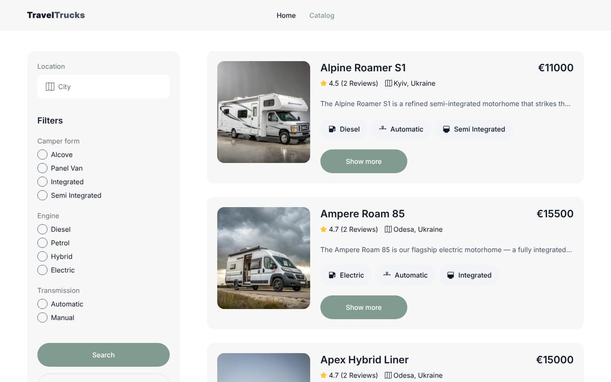
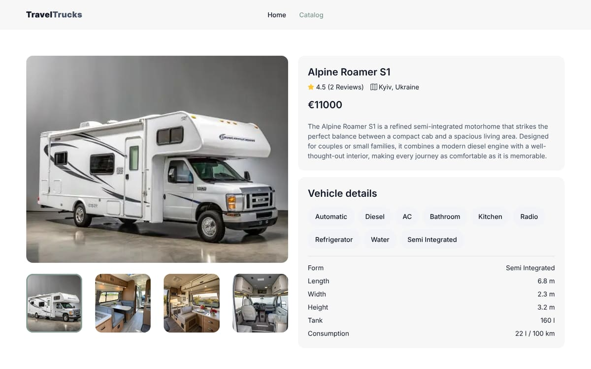

# TravelTrucks

A camper rental website. Visitors browse a catalog of campers, filter it by location, body type,
engine and transmission, look through the photos, specifications and reviews of a camper, and send
a booking request.

**Live site:** [travel-trucks-tawny-nine.vercel.app](https://travel-trucks-tawny-nine.vercel.app)



## Features

- **Home page** with a full-screen hero and a link straight to the catalog.
- **Catalog** (`/catalog`)
  - Filters for location (city search), camper form, engine and transmission. Filtering runs on the
    server side of the API, and the chosen options apply when you press **Search**.
  - Cards with the price, rating, location, a one-line description and the key features.
  - **Load more** pagination, 4 campers at a time.
  - A "No campers found" state with buttons that clear the filters and show all campers again.
  - The first page is fetched on the server, so the catalog appears without a loading step.
- **Camper page** (`/catalog/[camperId]`)
  - Photo gallery with thumbnails.
  - Full description, every feature, and the vehicle specifications.
  - Guest reviews with star ratings.
  - Booking form with validation (name and email). A notification confirms a successful request.
- **Loading and error states**: a loader over the page while data loads, plus a custom 404 page
  and an error page with a retry button.
- **Responsive layout** for desktop, tablet and phone.
- **SEO**: page titles and descriptions, link previews (Open Graph and Twitter cards) and a favicon.
- **Accessibility**: semantic markup, labelled form fields and filter groups, and keyboard-friendly
  controls.



## Tech stack

| Area                 | Tools                                           |
| -------------------- | ----------------------------------------------- |
| Framework            | Next.js 16 (App Router), React 19, TypeScript   |
| Data fetching        | TanStack Query (with server prefetch), Axios    |
| State                | Zustand (filters)                               |
| Forms and validation | Formik, Yup                                     |
| Styling              | CSS Modules, modern-normalize, Fontsource fonts |
| Notifications        | react-hot-toast                                 |
| Tooling              | ESLint, Prettier, React Compiler                |
| Hosting              | Vercel                                          |

Data comes from a public REST API: `https://campers-api.goit.study`.

## Getting started

Requirements: Node.js 20 or newer.

```bash
git clone https://github.com/viktor-tar/travel-trucks.git
cd travel-trucks
npm install
npm run dev
```

Then open [http://localhost:3000](http://localhost:3000). No environment variables are needed.

## Scripts

| Command             | What it does                  |
| ------------------- | ----------------------------- |
| `npm run dev`       | Start the development server  |
| `npm run build`     | Build for production          |
| `npm start`         | Run the production build      |
| `npm run lint`      | Check the code with ESLint    |
| `npm run typecheck` | Check types with TypeScript   |
| `npm run format`    | Format the code with Prettier |

## Project structure

```
app/
  page.tsx                 Home page
  catalog/
    page.tsx               Catalog: metadata and server prefetch of the first page
    CatalogClient.tsx      Catalog: filters, list, empty state and loader
    [camperId]/            Camper page
  loading.tsx, error.tsx, not-found.tsx
components/                Reusable UI: Button, Badge, Loader, TextField, CamperCard, …
lib/
  api/campers.ts           API requests
  camper.ts                Labels and formatting for camper data
  store/filterStore.ts     Filter state (Zustand)
types/                     TypeScript types for the API data
public/                    Images and the icon sprite
```

## Author

Built by **Victor Tar** · [LinkedIn](https://www.linkedin.com/in/viktor-tar/) ·
[GitHub](https://github.com/viktor-tar). Developed with AI-assisted tooling (Claude Code).
